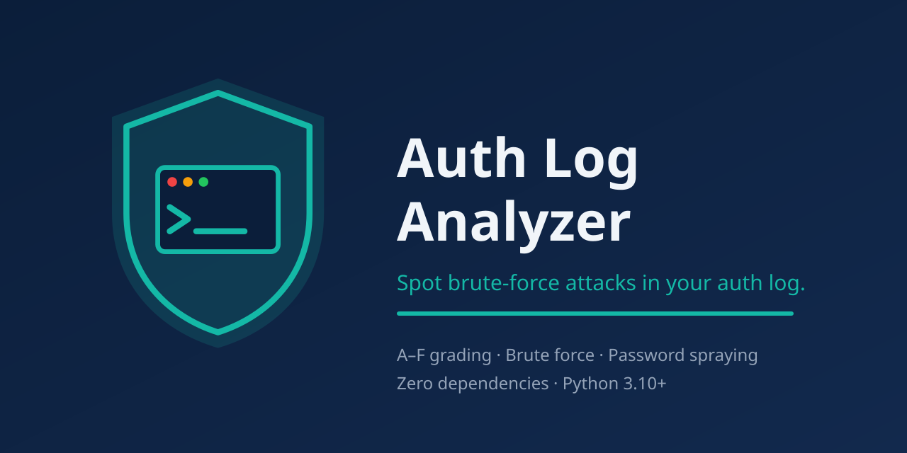
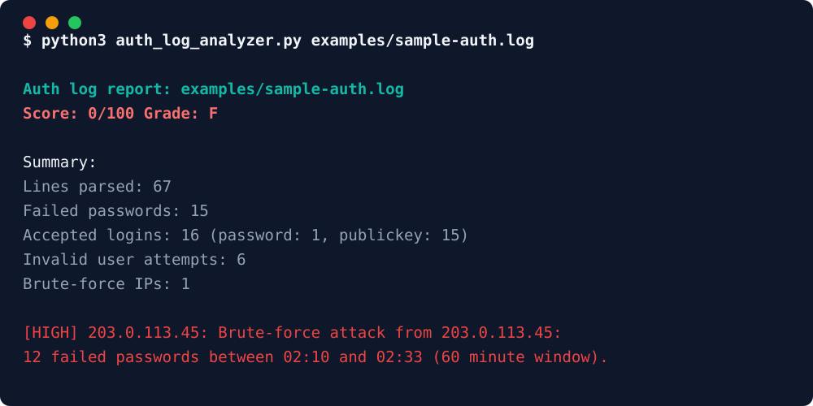
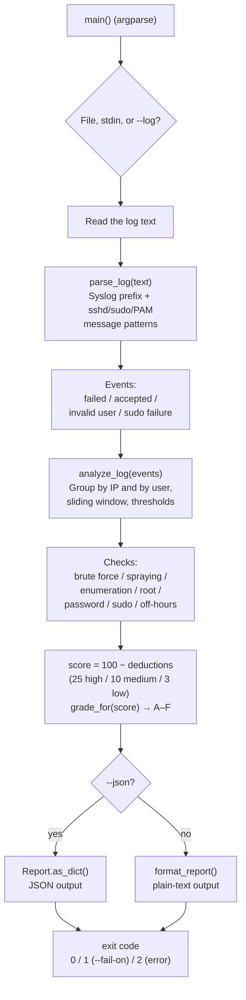

<p align="center">
  
</p>

<h1 align="center">Auth Log Analyzer</h1>

<p align="center"><strong>Parse a Linux auth log, spot SSH brute-force attacks, password spraying, and suspicious logins, and get an A-F grade with a fix for every finding.</strong></p>

<p align="center">
  <a href="LICENSE"></a>
  <a href="https://github.com/sajidhussainraza/auth-log-analyzer/releases"></a>
  <a href="https://github.com/sajidhussainraza/auth-log-analyzer/stargazers"></a>
  <a href="https://github.com/sajidhussainraza/auth-log-analyzer/network/members"></a>
  <a href="https://github.com/sajidhussainraza/auth-log-analyzer/issues"></a>
  <a href="https://github.com/sajidhussainraza/auth-log-analyzer/commits/main"></a>
  <a href="https://github.com/sajidhussainraza/auth-log-analyzer/actions/workflows/ci.yml"></a>
  <a href="https://www.python.org/downloads/"></a>
  <a href="CONTRIBUTING.md"></a>
</p>

<p align="center">
  <a href="#demo">Demo</a> |
  <a href="#quick-start">Quick Start</a> |
  <a href="#installation">Install</a> |
  <a href="docs/demo-capture.md">Docs</a> |
  <a href="https://github.com/sajidhussainraza/auth-log-analyzer/issues/new?template=bug_report.yml">Report Bug</a> |
  <a href="https://github.com/sajidhussainraza/auth-log-analyzer/issues/new?template=feature_request.yml">Request Feature</a>
</p>

## Why this exists

**Problem:** a Linux server under attack leaves the evidence in
`/var/log/auth.log`, but the log is thousands of lines of noise.
A brute-force attack looks like a few ordinary "Failed password"
lines, a successful login after those failures looks like a normal
user logging in, and password spraying across many IPs never shows
up as one event at all. Nobody reads the whole log by hand.
**Solution:** this dependency-free Python CLI parses the log,
groups the attempts by IP and by username inside a sliding time
window, and grades the host A-F with a plain-language fix for
every finding.
**Result:** you know in seconds whether a host is quiet, is being
probed, or has already let an attacker in, and exactly which IP,
account, and hour to investigate first.

## Demo



> Static preview, not an animated GIF: the image above is a rendering of
> real output (the full output is saved in
> [`examples/sample-output.txt`](examples/sample-output.txt)).
> A real demo GIF has not been recorded yet; the exact capture script is in
> [`docs/demo-capture.md`](docs/demo-capture.md).

## Features

- 🕵️ **Brute-force detection**: flags an IP with 5 or more failed
  passwords inside a 60-minute window (both configurable), using a
  sliding window so attacks split across the hour boundary are still caught
- 🎯 **Password spraying found**: one username tried from three or
  more IPs is a different attack from a brute force, and it is flagged
  separately
- 🚨 **Successful login after failures**: a login that follows failed
  attempts from the same IP is flagged as a possible compromise, not
  treated as a normal login
- 🔍 **User enumeration**: "Invalid user" probes are counted, so you
  see an attacker mapping which accounts exist
- 🔑 **Root and password logins flagged**: direct root attempts and
  accepted password logins are called out, because keys are the fix
- 🌙 **Off-hours logins**: accepted logins between 00:00 and 06:00
  are listed for a second look
- 🛡️ **Sudo failures**: sudo and PAM authentication failures are
  counted, so privilege-escalation attempts are visible
- 📊 **A-F grading with a 0-100 score**: compare any two hosts at a
  glance, and track a host as you harden it
- 🗣️ **Plain-language findings, each with a fix**: no jargon, no guessing what to change next
- 📥 **File, stdin, or inline input**: analyse `/var/log/auth.log`,
  pipe a log through stdin with `-`, or test one line with `--log`
- 🤖 **CI ready**: `--json` for machine-readable output and
  `--fail-on` to fail a build on findings above a severity, so a bad
  log can block a deploy
- 🪶 **Zero dependencies**: Python standard library only, nothing to install, nothing to update

## Table of contents

- [Quick Start](#quick-start)
- [Installation](#installation)
- [Usage](#usage)
- [CLI reference](#cli-reference)
- [Configuration](#configuration)
- [How grading works](#how-grading-works)
- [What it checks](#what-it-checks)
- [Live results](#live-results)
- [Architecture](#architecture)
- [Project structure](#project-structure)
- [Teaching notes](#teaching-notes)
- [Tests](#tests)
- [FAQ](#faq)
- [Roadmap](#roadmap)
- [Contributing](#contributing)
- [License](#license)
- [Acknowledgements](#acknowledgements)

## Quick Start

The fastest path to a working result, under 60 seconds. You need only
Python 3.10+; there is nothing to install.

```bash
git clone https://github.com/sajidhussainraza/auth-log-analyzer.git
cd auth-log-analyzer
python3 auth_log_analyzer.py examples/sample-auth.log
```

Expected output (real output, captured 23 November 2026):

```
Auth log report: examples/sample-auth.log
Score: 0/100  Grade: F

Summary:
  Lines parsed: 67
  Malformed lines skipped: 2
  Failed passwords: 15
  Failed public keys: 1
  Accepted logins: 16 (password: 1, publickey: 15)
  Invalid user attempts: 6
  Sudo authentication failures: 3
  Unique source IPs: 7
  Brute-force IPs: 1

Top source IPs by failed passwords:
  203.0.113.45     failed: 12  accepted: 1   invalid users: 4
  198.51.100.77    failed: 2   accepted: 0   invalid users: 0
  192.0.2.50       failed: 1   accepted: 0   invalid users: 0
  198.51.100.23    failed: 0   accepted: 7   invalid users: 0
  192.168.1.10     failed: 0   accepted: 5   invalid users: 0
  192.168.1.20     failed: 0   accepted: 3   invalid users: 0
  198.51.100.99    failed: 0   accepted: 0   invalid users: 2

Findings (8):
  [HIGH] 203.0.113.45: Brute-force attack from 203.0.113.45: 12 failed passwords between 02:10 and 02:33 (60 minute window).
        Fix: Block 203.0.113.45 at the firewall (fail2ban or an iptables rule), check whether any account it tried was compromised, and move SSH to key-only authentication.
  [HIGH] 203.0.113.45: Successful password login for admin from 203.0.113.45 at 02:51 came after 12 failed password attempt(s) from the same IP in the previous 60 minutes. This may be a compromised account.
        Fix: Treat admin's account as possibly compromised: force a password reset, review what that session did, and revoke any keys or sessions created by it.
  [HIGH] admin: Password spraying against admin: 8 failed passwords from 3 different IPs (192.0.2.50, 198.51.100.77, 203.0.113.45). One password is being tried against one account from many addresses.
        Fix: Lock or rotate the admin account, check it for unauthorised changes, and rate-limit logins per account as well as per IP.
  [MEDIUM] sshd: User enumeration: 6 attempts probed 6 usernames that do not exist (backup, guest, operator, oracle, testuser, webadmin). An attacker is mapping which accounts exist on this host.
        Fix: Do not reveal whether a username exists: keep sshd's default behaviour, disable password authentication, and block the probing IPs.
  [MEDIUM] root: Root login attempts: 2 failed and 0 accepted. Direct root login is the first thing an attacker tries.
        Fix: Set PermitRootLogin no in sshd_config and log in as a normal user, then use sudo. Rotate the root password if any root login succeeded.
  [MEDIUM] sshd: Password authentication accepted 1 time(s) (admin). Passwords can be guessed; SSH keys cannot.
        Fix: Move to key-only authentication: set PasswordAuthentication no in sshd_config and give every user an SSH key.
  [MEDIUM] sudo: Sudo authentication failures: 3 failed attempt(s) for alice, bob. Somebody is trying to escalate to root.
        Fix: Check who was at the keyboard for each failure, review sudoers for accounts that should not have sudo, and alert on repeated sudo failures.
  [LOW] sshd: Off-hours logins: 2 accepted login(s) between 00:00 and 06:00 (admin from 203.0.113.45 at 02:51, deploy from 198.51.100.23 at 03:12). Logins at this hour deserve a second look.
        Fix: Confirm each off-hours login was expected (on-call work, a scheduled job, a different timezone). If not, treat the account as possibly compromised.
```

The sample log is deliberately a host under active attack, which is
why it scores 0/100, grade F. A quiet host with only key logins
scores 100/100, grade A (see [Usage](#usage)).

## Installation

### Prerequisites

| Requirement | Version | Notes |
| --- | --- | --- |
| Python | 3.10 or newer | 3.10+ is required: the code uses `str \| None` annotations (PEP 604). Check with `python3 --version`. |
| Git | Any recent version | Only needed to clone the repo; you can also download the ZIP from GitHub. |
| A log file | None | Any syslog-style auth log (`/var/log/auth.log` on Debian/Ubuntu, `/var/log/secure` on RHEL). The sample log in `examples/` works without one. |
| Third-party packages | None | Standard library only (`argparse`, `json`, `re`, `datetime`). There is no `requirements.txt` because there is nothing to install. |

### Windows

```powershell
git clone https://github.com/sajidhussainraza/auth-log-analyzer.git
cd auth-log-analyzer
py auth_log_analyzer.py examples\sample-auth.log
```

Use `py` (the Python launcher) if `python3` is not recognised. On
Windows, `python` usually works too. Windows has no `/var/log/auth.log`,
so analyse a copied log file or use `--log` with pasted lines.

### macOS

```bash
git clone https://github.com/sajidhussainraza/auth-log-analyzer.git
cd auth-log-analyzer
python3 auth_log_analyzer.py examples/sample-auth.log
```

macOS ships a system Python that may be older than 3.10. If
`python3 --version` reports below 3.10, install a newer Python from
[python.org](https://www.python.org/downloads/) or with
`brew install python`.

### Linux

```bash
git clone https://github.com/sajidhussainraza/auth-log-analyzer.git
cd auth-log-analyzer
python3 auth_log_analyzer.py /var/log/auth.log
```

Most current distributions already ship Python 3.10+. On Debian/Ubuntu,
`sudo apt install python3` gets you a working interpreter. Reading
`/var/log/auth.log` usually needs root or membership in the `adm`
group: `sudo python3 auth_log_analyzer.py /var/log/auth.log`.

### Install from source

There is no package to install and no build step. Cloning the repo
*is* the install: `auth_log_analyzer.py` is a single
self-contained file. Copy it anywhere and run it:

```bash
cp auth_log_analyzer.py /usr/local/bin/auth-log-analyzer   # optional, Linux/macOS
chmod +x /usr/local/bin/auth-log-analyzer
auth-log-analyzer /var/log/auth.log
```

### Verify the install

```bash
python3 tests/run_tests.py   # 52 tests, all offline
python3 auth_log_analyzer.py examples/sample-auth.log
```

The second command should print `Score: 0/100  Grade: F` and exit 0
(the sample log is a host under attack; the grade is the point).

### Troubleshooting

| Error | Cause | Fix |
| --- | --- | --- |
| `python3: command not found` | Python is not installed, or not on PATH | Install Python 3.10+ from python.org; on Windows use `py` instead of `python3` |
| `Error: could not read /var/log/auth.log (...)` (exit 2) | No permission to read the log, or the path is wrong | Use `sudo`, or copy the log to a readable location first |
| `Error: Give a log file to analyse, or log text with --log` (exit 2) | No log file and no `--log` were given | Give one or the other, not neither |
| `Error: --log and a log file cannot be used together` (exit 2) | Both were given at once | Analyse the file, or the inline text, in separate runs |
| `Error: --threshold must be at least 1` (exit 2) | `--threshold 0` or negative | Use a threshold of 1 or more |
| `SyntaxError` on `str \| None` | Python older than 3.10 | Upgrade to Python 3.10+; this syntax (PEP 604) does not work on 3.8/3.9 |
| Score 100 on a log you know was attacked | The attack lines are in a different file, or a different format | Check the log path (`/var/log/secure` on RHEL, not `auth.log`), and check the lines match the syslog format the tool parses |

## Usage

### Basic: analyse a log file

This is the core use case: a quick check of a host's auth log.

```bash
python3 auth_log_analyzer.py /var/log/auth.log
```

A quiet host with only key logins looks like this (real output,
from two inline lines, 23 November 2026):

```bash
python3 auth_log_analyzer.py --log "Nov 23 08:02:11 webserver sshd[2041]: Accepted publickey for alice from 192.168.1.10 port 51234 ssh2
Nov 23 08:05:44 webserver sshd[2055]: Accepted publickey for bob from 198.51.100.23 port 44120 ssh2"
```

```
Auth log report: inline log text
Score: 100/100  Grade: A

Summary:
  Lines parsed: 2
  Failed passwords: 0
  Failed public keys: 0
  Accepted logins: 2 (password: 0, publickey: 2)
  Invalid user attempts: 0
  Sudo authentication failures: 0
  Unique source IPs: 2
  Brute-force IPs: 0

Top source IPs by failed passwords:
  192.168.1.10     failed: 0   accepted: 1   invalid users: 0
  198.51.100.23    failed: 0   accepted: 1   invalid users: 0

Findings (1):
  [INFO] log: No failed login attempts at all in this log: no failed passwords, no invalid-user probes, and no sudo failures. Either the host is quiet, or the log covers a short period.
        Fix: Keep watching: a clean log is good news, not a reason to stop checking. Run this tool on a regular schedule.
```

### Intermediate: pipe a log through stdin, and tune the threshold

```bash
sudo grep sshd /var/log/auth.log | python3 auth_log_analyzer.py -
```

```bash
cat /var/log/auth.log | python3 auth_log_analyzer.py - --json --fail-on high
```

The threshold and window change what counts as an attack. With a
higher threshold the same sample log no longer flags a brute force
(real output, 23 November 2026):

```bash
python3 auth_log_analyzer.py examples/sample-auth.log --threshold 15 --window-minutes 30
```

```
Auth log report: examples/sample-auth.log
Score: 32/100  Grade: F

Summary:
  Lines parsed: 67
  Malformed lines skipped: 2
  Failed passwords: 15
  Failed public keys: 1
  Accepted logins: 16 (password: 1, publickey: 15)
  Invalid user attempts: 6
  Sudo authentication failures: 3
  Unique source IPs: 7
  Brute-force IPs: 0

Top source IPs by failed passwords:
  203.0.113.45     failed: 12  accepted: 1   invalid users: 4
  198.51.100.77    failed: 2   accepted: 0   invalid users: 0
  192.0.2.50       failed: 1   accepted: 0   invalid users: 0
  198.51.100.23    failed: 0   accepted: 7   invalid users: 0
  192.168.1.10     failed: 0   accepted: 5   invalid users: 0
  192.168.1.20     failed: 0   accepted: 3   invalid users: 0
  198.51.100.99    failed: 0   accepted: 0   invalid users: 2

Findings (6):
  [HIGH] 203.0.113.45: Successful password login for admin from 203.0.113.45 at 02:51 came after 5 failed password attempt(s) from the same IP in the previous 30 minutes. This may be a compromised account.
        Fix: Treat admin's account as possibly compromised: force a password reset, review what that session did, and revoke any keys or sessions created by it.
  [MEDIUM] sshd: User enumeration: 6 attempts probed 6 usernames that do not exist (backup, guest, operator, oracle, testuser, webadmin). An attacker is mapping which accounts exist on this host.
        Fix: Do not reveal whether a username exists: keep sshd's default behaviour, disable password authentication, and block the probing IPs.
  [MEDIUM] root: Root login attempts: 2 failed and 0 accepted. Direct root login is the first thing an attacker tries.
        Fix: Set PermitRootLogin no in sshd_config and log in as a normal user, then use sudo. Rotate the root password if any root login succeeded.
  [MEDIUM] sshd: Password authentication accepted 1 time(s) (admin). Passwords can be guessed; SSH keys cannot.
        Fix: Move to key-only authentication: set PasswordAuthentication no in sshd_config and give every user an SSH key.
  [MEDIUM] sudo: Sudo authentication failures: 3 failed attempt(s) for alice, bob. Somebody is trying to escalate to root.
        Fix: Check who was at the keyboard for each failure, review sudoers for accounts that should not have sudo, and alert on repeated sudo failures.
  [LOW] sshd: Off-hours logins: 2 accepted login(s) between 00:00 and 06:00 (admin from 203.0.113.45 at 02:51, deploy from 198.51.100.23 at 03:12). Logins at this hour deserve a second look.
        Fix: Confirm each off-hours login was expected (on-call work, a scheduled job, a different timezone). If not, treat the account as possibly compromised.
```

Raising the threshold hid the brute-force and spraying findings but
the host is still grade F: the other findings are real and independent
of the threshold. Tuning the threshold changes sensitivity, it does
not make an attacked host clean.

Machine-readable output for scripts and dashboards:

```bash
python3 auth_log_analyzer.py examples/sample-auth.log --json
```

```json
{
  "source": "examples/sample-auth.log",
  "counts": {
    "total_lines": 67,
    "parsed_lines": 65,
    "malformed_lines": 2,
    "failed_passwords": 15,
    "failed_publickeys": 1,
    "accepted_logins": 16,
    "accepted_passwords": 1,
    "accepted_publickeys": 15,
    "invalid_user_attempts": 6,
    "sudo_failures": 3,
    "unique_ips": 7,
    "brute_force_ips": [
      "203.0.113.45"
    ]
  },
  "top_ips": [
    {
      "ip": "203.0.113.45",
      "failed": 12,
      "accepted": 1,
      "invalid_users": 4
    }
  ],
  "score": 0,
  "grade": "F",
  "findings": [
    {
      "severity": "high",
      "source": "203.0.113.45",
      "message": "Brute-force attack from 203.0.113.45: 12 failed passwords between 02:10 and 02:33 (60 minute window).",
      "fix": "Block 203.0.113.45 at the firewall (fail2ban or an iptables rule), check whether any account it tried was compromised, and move SSH to key-only authentication."
    }
  ]
}
```

(The full JSON, with all 7 top IPs and all 8 findings, is saved in
[`examples/sample-output.json`](examples/sample-output.json). The
`top_ips` list above is shortened to the first entry for readability.)

### Advanced: use it as a CI security gate

Fail a build when the log has high-severity findings, for example
in a nightly job that ships a server's auth log to a checker:

```bash
python3 auth_log_analyzer.py /var/log/auth.log --fail-on high
echo $?   # 1: a high-severity finding was found; 0: clean at that level
```

Combine it with `--json` to feed the findings into your own reporting:

```bash
python3 auth_log_analyzer.py /var/log/auth.log --json --fail-on medium > auth-report.json
```

#### Exit codes

| Code | Meaning |
| --- | --- |
| 0 | No findings at or above `--fail-on` |
| 1 | Findings at or above `--fail-on` were found |
| 2 | Usage error (missing file, bad flags, unreadable log) |

Note: the checker only sees what the log records. An attack that
leaves no trace in the auth log (a stolen key used once, a login
through another service) is invisible to it. It also reads the log
as it is: rotated or truncated logs show only the period they cover.

## CLI reference

| Flag / argument | Description |
| --- | --- |
| `logfile` (positional) | Path to the auth log file, e.g. `/var/log/auth.log`. Use `-` to read from stdin. |
| `--log TEXT` | Analyse log text given on the command line instead of a file. Cannot be combined with a log file. |
| `--threshold N` | Failed passwords from one IP (or one user) that flag brute force / spraying. Default: `5`. |
| `--window-minutes N` | Minutes the failed attempts must fall inside to count as an attack. Default: `60`. |
| `--json` | Print the report as JSON instead of plain text. |
| `--fail-on {high,medium,low,none}` | Exit 1 when findings at or above this severity are found. Default: `none` (always exit 0 unless there is a usage or file error). |
| `--version` | Print the version and exit. |
| `-h`, `--help` | Show the built-in help and exit. |

## Configuration

There is no configuration file and no environment variable to set.
Every behaviour is controlled by the command-line flags above.

| Option | Type | Default | Description |
| --- | --- | --- | --- |
| `logfile` | string | None | Log file to analyse, or `-` for stdin. |
| `--log` | string | None | Inline log text to analyse. |
| `--threshold` | int | 5 | Failed passwords that flag brute force / spraying. |
| `--window-minutes` | int | 60 | Minutes the failures must fall inside. |
| `--json` | flag | off | JSON output instead of plain text. |
| `--fail-on` | `high` / `medium` / `low` / `none` | `none` | Severity threshold that makes the exit code 1. |
| `--version` | flag | None | Print the version (`1.0.0`) and exit. |
| Off-hours window | None | 00:00-06:00 | Accepted logins in this window are flagged low. |

No secrets are involved anywhere: the tool reads a local file and
makes no network calls. Auth logs are sensitive (real usernames, IP
addresses, login times), so redact them before sharing a sample.

## How grading works

Score starts at 100 and deducts **25 / 10 / 3** per high / medium / low
finding:

| Score | Grade |
| --- | --- |
| 90-100 | A |
| 80-89 | B |
| 70-79 | C |
| 60-69 | D |
| 0-59 | F |

Findings are graded by severity:

| Severity | Examples |
| --- | --- |
| High | Brute-force attack, successful login after failures from the same IP, password spraying |
| Medium | User enumeration, root login attempts, password authentication accepted, sudo authentication failures |
| Low | Off-hours login (00:00-06:00) |
| Info | No failed login attempts at all (no deduction) |

## What it checks

| Check | What a good result looks like |
| --- | --- |
| Brute force | No IP has 5 or more failed passwords in 60 minutes |
| Successful login after failures | No accepted login follows failures from the same IP |
| Password spraying | No username is tried from 3 or more IPs |
| User enumeration | Fewer than 5 usernames that do not exist are probed |
| Root login attempts | No failed or accepted logins for root |
| Password authentication | No accepted password logins; keys only |
| Sudo authentication failures | No sudo or PAM authentication failures |
| Off-hours logins | No accepted logins between 00:00 and 06:00 |
| Malformed lines | None: every line parses (malformed lines are skipped and counted, never fatal) |

Three subtleties are handled, not just pattern-matched:

- The brute-force check uses a sliding window, not a calendar hour.
  Five failures at 10:55 and five at 11:05 are one attack, not two
  quiet hours, and the tool catches that.
- A successful login after failures is judged per IP, not per user.
  An attacker who guesses the right password after 12 failures looks
  exactly like a user logging in, unless you check what that IP did
  just before.
- Password spraying is the mirror image of a brute force: one
  username, many IPs. Per-IP rate limiting never sees it, because no
  single IP crosses the threshold. Grouping failures by username
  catches it.

Known limitation: the tool reads the log as it is. It cannot tell a
user mistyping a password twice from an attacker trying twice, which
is why the default threshold is 5, not 1. It also cannot see attacks
that leave no trace in the auth log. See the [roadmap](#roadmap).

## Live results

Real analysis of the shipped sample log, captured 23 November 2026.
The full outputs are saved in [`examples/`](examples/).

| Log | Score | Grade | What stood out |
| --- | --- | --- | --- |
| [`examples/sample-auth.log`](examples/sample-auth.log) (67 lines) | 0/100 | F | Brute force from 203.0.113.45, a successful password login after 12 failures, password spraying against admin, 6 invalid users probed, root attempts, sudo failures, 2 off-hours logins |
| Same log, `--threshold 15 --window-minutes 30` | 32/100 | F | Brute force and spraying no longer fire, but the other 6 findings are real and independent of the threshold |
| Two clean key logins (`--log`) | 100/100 | A | No failed attempts at all, reported as an info finding |

The sample log deserves a careful read rather than a shrug: it is a
synthetic log (all IPs are documentation ranges), but every line in
it is a line a real attacked host produces. The point of the tool is
that a human reading 67 lines would spot the attack; a human reading
67,000 lines would not.

## Architecture



The tool is a single file with no dependencies: `parse_log` turns
text into events, `analyze_log` is a pure function of the events
(so it is easy to test offline with synthetic logs), and the output
layer is separate from the analysis.

## Project structure

```
auth-log-analyzer/
├── auth_log_analyzer.py    # The whole tool: parse, analyse, grade, report
├── README.md               # This file
├── LICENSE                 # MIT
├── CHANGELOG.md            # Version history (Keep a Changelog + SemVer)
├── CONTRIBUTING.md         # How to contribute
├── CODE_OF_CONDUCT.md      # Contributor Covenant 2.1
├── SECURITY.md             # How to report a vulnerability
├── .gitignore              # Python / editor / OS artefacts
├── .editorconfig           # Indentation and line endings
├── assets/
│   ├── banner.svg          # README banner (1280x640)
│   ├── logo.svg            # Square logo, works at 64px
│   └── demo.svg            # Static terminal preview shown above
├── docs/
│   └── demo-capture.md     # Exact script for recording a real demo.gif
├── examples/
│   ├── sample-auth.log     # Synthetic 67-line log: brute force, spraying, enumeration, root, off-hours, sudo
│   ├── sample-output.txt   # Real text output for the sample log
│   └── sample-output.json  # Real JSON output for the sample log
├── tests/
│   ├── test_auth_log_analyzer.py  # 52 tests (stdlib unittest)
│   └── run_tests.py        # Test runner, no pytest needed
└── .github/
    ├── ISSUE_TEMPLATE/
    │   ├── bug_report.yml
    │   ├── feature_request.yml
    │   └── config.yml
    ├── PULL_REQUEST_TEMPLATE.md
    └── workflows/
        └── ci.yml          # Tests on Ubuntu / Windows / macOS, Python 3.10-3.13
```

## Comparison with alternatives

Skipped: no competing tools were given to compare against, so there is
no comparison table here. If you know an auth-log checker this should be
measured against, open a
[feature request](https://github.com/sajidhussainraza/auth-log-analyzer/issues/new?template=feature_request.yml)
and it can be added with real, verifiable numbers.

## Teaching notes

This tool pairs well with a lesson on SSH attacks: run it against
the sample log, then change the threshold and watch the grade move.
Good discussion points:

- Why a brute-force attack is a counting problem, not a pattern
  problem: one "Failed password" line is normal, twelve in 23
  minutes from one IP is an attack, and the difference is the window.
- Why a sliding window matters: an attacker who spreads attempts
  across an hour boundary defeats a per-hour count.
- Why a successful login after failures is the most important
  finding: it may mean the attacker is already in, and the response
  is incident response, not hardening.
- Why password spraying defeats per-IP rate limiting: no single IP
  crosses the threshold, so fail2ban never fires, and the fix is
  per-account rate limiting.
- Why user enumeration matters even though no account was broken
  into: the attacker is building a list of real accounts for the
  next attack.
- Why password authentication is the root cause of most of these
  findings: keys cannot be guessed, so key-only authentication
  removes the whole class.
- Why off-hours logins are only low severity: a 03:12 login can be
  legitimate on-call work, so it is flagged for a human to confirm,
  not treated as proof of compromise.

### Lab exercise for students

1. Run the tool on `examples/sample-auth.log` and note the score.
2. Open the log and delete the 12 brute-force lines from
   203.0.113.45. Run the tool again: what changed, and what did not?
3. Now delete the accepted password login for admin as well. What is
   the score now, and which findings remain?
4. Write your own 10-line log with a brute-force attack from a
   different IP and a threshold of 3, and check the tool flags it.
5. As a stretch goal: add a check of your own (for example, flag
   logins from a country your team never works in) with a test, and
   open a pull request.

## Tests

```bash
python3 tests/run_tests.py   # 52 tests, all offline
```

52/52 tests pass. The tests cover parsing of every line type,
brute-force detection at the threshold, window expiry, successful
login after failures, user enumeration, root attempts, password vs
key, off-hours logins, sudo failures, password spraying, grading
boundaries, JSON output shape, `--fail-on` exit codes, malformed
lines, and empty logs. (pytest is also supported if it is installed:
`python3 -m pytest tests/ -q`.)

## FAQ

**Why does the sample log score 0/100?**
Because it is deliberately a host under active attack: 3 high
findings (25 points each) plus 4 medium (10 each) plus 1 low (3)
deduct 118 points, and the score floors at 0. A quiet host scores
100. The sample log is built to show every check firing at once.

**Why is a successful login after failures high, not medium?**
Because it may mean the attacker is already inside. A failed
attempt is a knock on the door; a successful login after failures
from the same IP may be the door opening. That changes the response
from hardening to incident response.

**Why is password spraying high when no single IP looks bad?**
Because it is a distributed attack against one account. Per-IP
limits never see it, which is exactly why attackers use it. The fix
is per-account rate limiting and locking the targeted account.

**Why is user enumeration only medium?**
Because probing usernames that do not exist does not by itself break
into an account. It is a warning that an attacker is mapping the
host, and the fix (disable password authentication) is the same fix
as for the other findings.

**Why are off-hours logins only low?**
Because a 03:12 login can be legitimate: on-call work, a scheduled
job, a colleague in another timezone. It is flagged so a human
confirms it, not treated as proof of compromise.

**Why is the threshold 5 by default?**
Because a user mistyping a password once or twice is normal, and a
tool that cries wolf on every typo gets ignored. Five failures from
one IP in an hour is not a typo. Raise it if your users are noisy,
lower it if your host is exposed.

**Does it work on RHEL / CentOS logs?**
Yes, if the lines are syslog-style. On RHEL the file is
`/var/log/secure` instead of `/var/log/auth.log`; pass that path.
The message formats (`Failed password for ...`, `Accepted ...`) are
the same OpenSSH formats on both.

**Does it read compressed or rotated logs?**
No. Pass it one log file at a time. For a rotated log, decompress
it first (`gunzip -c auth.log.1.gz | python3 auth_log_analyzer.py -`)
or concatenate several days into one file before analysing.

**Can I use it in CI?**
Yes. `--json` gives machine-readable output and `--fail-on` turns
findings into a failing build. See
[Advanced usage](#advanced-use-it-as-a-ci-security-gate).

**Does it send anything anywhere?**
No. It reads a local file and makes no network calls. The only thing
that leaves your machine is what you choose to paste into an issue,
and auth logs should be redacted before sharing.

**Does it work on Windows?**
Yes. Any machine with Python 3.10+ runs it; use `py` instead of
`python3` if that is how Python is launched on your machine. CI tests
it on Ubuntu, Windows, and macOS. Windows has no auth.log, so analyse
a copied log file or use `--log`.

## Roadmap

- [ ] Record a real `demo.gif` (capture script: [`docs/demo-capture.md`](docs/demo-capture.md))
- [ ] Add a `--blocklist` option to flag logins from IPs on a supplied list
- [ ] Add a `--since` / `--until` option to analyse one time range
- [ ] Support journald (`journalctl -u sshd`) output as an input format
- [ ] Detect logins from a new country or ASN for a known user
- [ ] HTML report output alongside text and JSON
- [ ] Publish to PyPI (only if there is demand; the single-file script works fine as-is)

## Contributing

Contributions are welcome. See [CONTRIBUTING.md](CONTRIBUTING.md) for
the full guide. The short version:

1. Fork the repository and create a branch for your change.
2. Keep the tool dependency-free (Python standard library only).
3. Add or update tests in `tests/` for any behaviour you change.
4. Run the full suite and make sure all 52 tests pass:
   `python3 tests/run_tests.py`
5. Open a pull request describing the change and why it helps.

Please also follow the [Code of Conduct](CODE_OF_CONDUCT.md), and
report security issues privately as described in
[SECURITY.md](SECURITY.md), do not open a public issue for them.

## License

MIT. See [LICENSE](LICENSE) for the full text.

## Acknowledgements

- The [OpenSSH manual pages](https://www.openssh.com/manual.html)
  for the log formats this tool parses, and
  [OWASP](https://cheatsheetseries.owasp.org/cheatsheets/Authentication_Cheat_Sheet.html)
  for the authentication guidance behind the password and root checks.
- The [Contributor Covenant](https://www.contributor-covenant.org/) for
  the Code of Conduct, and [Keep a Changelog](https://keepachangelog.com/)
  for the changelog format.
- Everyone who reports a wrong score with a real log to back it up:
  that is how the checks get better.

## Star history

[](https://star-history.com/#sajidhussainraza/auth-log-analyzer&Date)

## Contributors

[](https://github.com/sajidhussainraza/auth-log-analyzer/graphs/contributors)

---

Built by [Cyber Legends](https://cyberlegends.org), cybersecurity
trainings, services and solutions.

**If this saved you time, please star the repo.**
